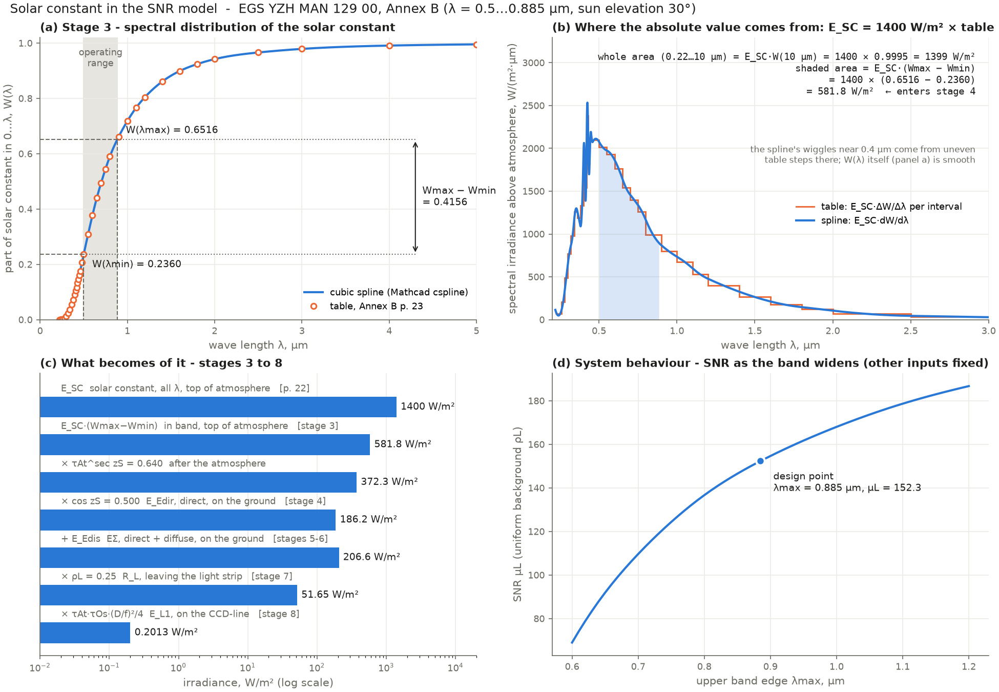

# CDC — Concurrent Design Center for Earth-observation missions

[](https://github.com/Shahd-M-Elkilany/CDC/actions/workflows/python.yml)
[](https://github.com/Shahd-M-Elkilany/CDC/actions/workflows/matlab.yml)
[](LICENSE)

A licence-free mission-design Concurrent Design Center, replacing the Mathcad
worksheets used for satellite payload design. It is built in small verified steps,
with **two equivalent implementations**:

- **Python**: no licence needed.
- **MATLAB**: for labs with MATLAB on every PC.

Both read the same reference data and must give the same numbers, and print the
same report character for character.

**Step 1 (done):** the signal/noise ratio of an electro-optical imager, following
EGS YZH MAN 129 00 (the `Video.mcd` method). Every value printed in the document's
worked example is reproduced to its last digit.

| µL (uniform ρL) | µD (uniform ρD) | µx (strips ⟂ track) | µy (strips ∥ track) |
|---|---|---|---|
| **152.3454** | **121.8763** | **4.2657** | **6.7032** |



---

## Contents

- [Quick start](#quick-start)
- [Repository layout](#repository-layout)
- [Step 1 — the SNR model](#step-1--the-snr-model)
- [The solar constant: where it comes from and where it goes](#the-solar-constant-where-it-comes-from-and-where-it-goes)
- [Verification](#verification)
- [Roadmap](#roadmap)
- [Branches and releases](#branches-and-releases)
- [License and source](#license-and-source)

## Quick start

### Python (3.10+)

```bash
cd python
python -m venv .venv
.venv\Scripts\activate                   # Linux/macOS: source .venv/bin/activate
pip install -e ".[dev]"

python -m cdc snr                        # full report for the Annex B example
python -m cdc snr --set D=0.2 --set nu_x=1000
python -m cdc snr -i my_inputs.json      # {"inputs": {"D": 0.2, ...}}; missing names = Annex B
python -m cdc snr --json                 # machine-readable results
python -m cdc snr --list-inputs          # the 27 inputs, units, defaults
python -m cdc snr --show                 # solar-constant figure in a window
python -m cdc snr --plot band.png --set lam_max=1e-6
pytest
```

```python
from cdc.snr import SNRInputs, calculate, format_report
p = SNRInputs(D=0.2, nu_x=1000)          # any of the 27 inputs; the rest = Annex B
r = calculate(p)                         # r.mu_L, r.mu_x, ... every stage value
print(format_report(p, r))
```

### MATLAB (R2023a or newer, no toolboxes)

```matlab
cd matlab
runSnr                                   % full report for the Annex B example
runSnr("D", 0.2, "nu_x", 1000)
runSnr("my_inputs.json")
r = runSnr("D", 0.2);                    % results struct, no printing
runSnr("--list")
runSnr("--plot")                         % solar-constant figure
buildtool                                % lint + tests

p = cdc.snr.defaultInputs("D", 0.2);
r = cdc.snr.calculate(p);
disp(cdc.snr.report(p, r))
```

### VS Code

Open the repository folder in VS Code (**File → Open Folder**). The `.vscode` folder
sets the interpreter to `python/.venv`, adds run buttons and recommends the Python,
Jupyter and MATLAB extensions.

| Way | How | Where the figure appears |
|---|---|---|
| **Run Cell** | open `python/examples/solar_figure.py`, click **Run Cell** above each `# %%` (or Shift+Enter) | Interactive window beside the code |
| **Run and Debug** | Ctrl+Shift+D → *SNR: show solar-constant figure* → F5 | its own window (zoom, pan, save) |
| **Terminal** | `cd python` then `.venv\Scripts\python -m cdc snr --show` | its own window |

## Repository layout

```
reference/                 shared test data, read by both implementations
  annex_b.json               Annex B inputs and the 38 printed values
  annex_b_report.txt         the expected report, character for character
python/
  src/cdc/snr/               inputs.py · model.py (stages 1–30) · report.py · plots.py
  src/cdc/__main__.py        command line:  python -m cdc snr ...
  examples/solar_figure.py   VS Code "Run Cell" walkthrough of the solar constant
  tests/                     pytest
matlab/
  +cdc/+snr/                 inputSpec · defaultInputs · validate · calculate · report
                             solarTable · solarFraction · inBandSolarConstant · plotSolar ...
  runSnr.m                   entry point
  tests/TestSNR.m            matlab.unittest
  buildfile.m                buildtool: lint + test
docs/                      figures used in this README
.github/workflows/         CI: python.yml (Ubuntu + Windows), matlab.yml (R2023a)
.vscode/                   interpreter, launch configurations, recommended extensions
```

## Step 1 — the SNR model

**Source:** *Method of calculation of signal/noise ratio for images received by the
electro-optical system of the Earth observation space system*, EGS YZH MAN 129 00,
Issue 1 (Yuzhnoye). The document gives:
- the inputs (§5.1)
- the 30 calculation stages (§5.2)
- the allowed ranges (§6)
- a worked example (Annex B)

The model follows the light from the Sun to the digital output:

1. Sun position and exposure time.
2. In-band solar irradiance: the spectral table and the solar constant.
3. Atmosphere: direct and diffuse irradiance.
4. Reflection from a test pattern.
5. Optics and the CCD-line: irradiance, exposure, electrons, voltage, with saturation at UCCDmax.
6. Amplifier and ADC range.
7. Image modulation through the videopath MTF.
8. Five noise sources: photon, photoreceiver, amplifier, ADC quantisation and digital-processor quantisation.
9. The four signal/noise ratios.

### Inputs (§5.1, Annex B values)

| Group | Name | Symbol | Annex B | Unit |
|---|---|---|---|---|
| Operating range | `lam_min`, `lam_max` | λmin, λmax | 0.500e-6, 0.885e-6 | m |
| Imaged region | `sun_elevation`, `rho_L`, `rho_D` | βS, ρL, ρD | 30, 0.25, 0.20 | deg, –, – |
| Atmosphere | `tau_At` | τAt | 0.80 | – |
| Optical system | `tau_Os`, `D`, `f` | τOs, D, f | 0.60, 0.155, 0.860 | –, m, m |
| CCD-line | `dzy`, `dy`, `dx`, `nu_x`, `Kt`, `N_El`, `Hn_CCD`, `RQ`, `KA`, `U_CCD_max` | ∆zy … UCCDmax | 10e-6, 10e-6, 10e-6, 900, 1, 6000, 4e-7, 1.563e18, 3.2e-6, 3.0 | m, m, m, Hz, –, –, J/m², e⁻/J, V/e⁻, V |
| Amplifier | `KU`, `TU`, `R_equ` | KU, TU, Requ | 3, 300, 10000 | –, K, Ω |
| ADC | `U_ADC_max`, `p_ADC` | UADCmax, pADC | 1, 12 | V, bits |
| Digital processor | `p_DP` | pDP | 8 | bits |
| Videopath MTF | `Tx`, `Ty` | Tx, Ty | 0.14, 0.22 | – |

Inputs outside the §6 ranges are rejected with a list of the broken rules. Examples:
- sun elevation must be 10–90°
- ρD ≤ ρL
- pDP ≤ pADC
- ∆y ≤ ∆zy

Saturation in stages 12–13 (CCD voltage, ADC input range) is applied as in the document
and reported in the output.

## The solar constant: where it comes from and where it goes

The model uses **two separate pieces** of the document:

| What | Value | Where in EGS YZH MAN 129 00 | In the code |
|---|---|---|---|
| **Absolute value**: solar constant E_SC | 1400 W/m² (whole spectrum, top of atmosphere) | §5.2 stage 4 (p. 13); Annex B "Constants used in the program" (p. 22) | `E_SC` (Python `cdc.snr.model`), `cdc.snr.solarTable().E_SC` (MATLAB) |
| **Relative distribution** W(λ): part of E_SC in 0…λ | 40 pairs, λ = 0.22…10 µm, W = 0…0.9995 | Annex B "Spectral distribution of solar constant" (p. 23) | `SOLAR_LAMBDA`, `SOLAR_W` / `solarTable().lambda`, `.W` |

The table gives only **fractions**; the watts come from E_SC. Stage 3 reads W(λmin) and
W(λmax) off the cubic spline (Mathcad `cspline` + `interp`), and stage 4 multiplies:

E_SC·(Wmax − Wmin) = 1400 × (0.6516 − 0.2360) = **581.8 W/m²** in the 0.5–0.885 µm band
above the atmosphere. Multiplying by τAt^sec zS × cos zS = 0.640 × 0.5 gives
**E_Edir = 186.169 W/m²** on the ground.

The four panels of the figure:

- **(a)** The table and its spline: the Mathcad plot.
- **(b)** The spectrum the table implies, E_SC·dW/dλ. Its whole area is the 1400 W/m²;
  the shaded area is the 581.8 W/m² that enters stage 4.
- **(c)** How that irradiance is reduced through stages 3–8, down to the CCD-line.
- **(d)** How the SNR responds when the band edge moves.

```matlab
e = cdc.snr.inBandSolarConstant(0.5e-6, 0.885e-6)   % 581.777 W/m²
cdc.snr.plotSolar(cdc.snr.defaultInputs(), "solar.png")
```

## Verification

- **Against the document:** every one of the 38 values Annex B prints (zS … µy) is
  checked to half a unit of its last printed digit, in both languages.
- **Python against MATLAB:** both generate the full report and compare it with
  `reference/annex_b_report.txt`, character for character.
- **Rules and edge cases:**
  - the §6 input rules
  - unknown input names
  - saturation clipping in stages 12–13
  - the in-band solar constant
  - the spectrum integrating back to the table
  - figure generation
- **CI on every push:**
  - Python 3.12 on Ubuntu and Windows: ruff, 63 pytest tests, the example script.
  - MATLAB R2023a: code issues, 50 matlab.unittest tests.

## Roadmap

| Step | Content | Status |
|---|---|---|
| **1** | **SNR model**: EGS YZH MAN 129 00 (Video.mcd), 27 inputs, 30 stages, 4 signal/noise ratios; solar-constant figures | **done** ([v0.1.0](https://github.com/Shahd-M-Elkilany/CDC/releases/tag/v0.1.0)) |
| 2 | Payload geometry: GSD, swath, line-rate match; SNR per spectral band (PAN + MS) | next |
| 3 | Orbit: altitude → ground speed, period, eclipse; feeds the payload | |
| 4 | Subsystem sheets: inputs / get parameter / send parameter; shared master sheet | |
| 5 | Requirements and comparison sheet: pass/fail by the nature of each parameter | |
| 6 | More subsystems: ADCS, power, mission performance (captured scene, location accuracy) | |
| 7 | Interface: master / subsystem / comparison sheets, trade & sensitivity, design options, Excel | |

## Branches and releases

- **`main`**: the step-by-step implementation (this README). Every step lands
  through a pull request with green CI.
- **`prototype`**: the earlier all-in-one Python CDC prototype, kept for reference.
- **Tags:**
  - `step-1`: the first verified SNR model.
  - `v0.1.0`: Step 1 complete, with the figures and VS Code support. See
    [CHANGELOG.md](CHANGELOG.md).

## License and source

Code: [MIT](LICENSE) © 2026 Shahd M. Elkilany.

The method, constants and worked example come from EGS YZH MAN 129 00 (Yuzhnoye). The
document itself is not included in this repository; the 40-point solar table and
the Annex B values are reproduced only as test data.
